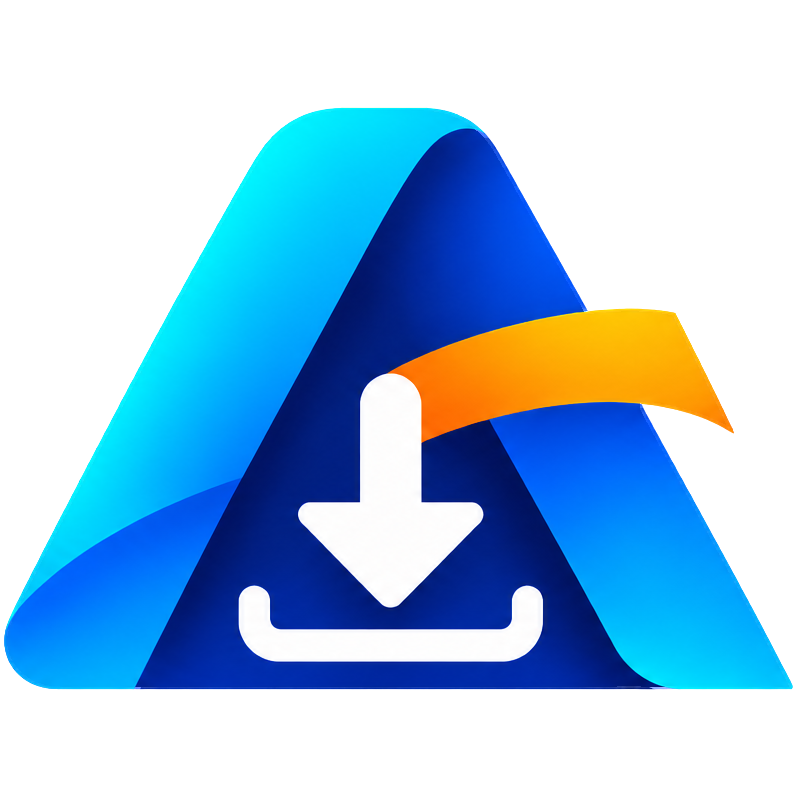

<p align="center">
  
</p>

<h1 align="center">Alternate Download Manager (ADM)</h1>

<p align="center">
  <b>The free, open-source IDM alternative for Windows.</b><br>
  Everything you use Internet Download Manager for: multi-connection downloads, resume, browser capture,
  a video grabber, queues and a scheduler. Free forever, with no trial, no licence key and no ads.
</p>

<p align="center">
  <a href="https://github.com/ashiqahmad07/alternate_download_manager/releases/latest"></a>
  <a href="https://github.com/ashiqahmad07/alternate_download_manager/actions/workflows/ci.yml"></a>
  <a href="LICENSE"></a>
  
  
</p>

<p align="center">
  <a href="https://github.com/ashiqahmad07/alternate_download_manager/releases/latest"><b>Download for Windows</b></a>
  ·
  <a href="#why-adm">Why ADM</a>
  ·
  <a href="#adm-and-idm-side-by-side">ADM vs IDM</a>
  ·
  <a href="#features">Features</a>
  ·
  <a href="#faq">FAQ</a>
</p>

---

ADM is a download manager and download accelerator for Windows 10 and 11. It splits each file across
up to 32 connections, resumes after crashes and power cuts, takes over downloads from Chrome, Edge and
Firefox, and saves video from YouTube, Facebook and the other sites
[yt-dlp](https://github.com/yt-dlp/yt-dlp) supports, along with HLS (`.m3u8`) and DASH (`.mpd`)
streams. It is written from scratch in C# and WPF, and its source is open under the MIT licence.

## Why ADM

- **Free, for good.** MIT-licensed: use it at home or at work, change it, share it. There is no trial
  that runs out, no serial number to buy, and no nag screen.
- **Fast.** Up to 32 connections per file with dynamic segmentation: when a connection is free, it takes
  over the part of the file expected to finish last, so one slow connection never holds up the end.
- **Downloads that survive anything.** Only bytes already on disk count as saved, so a crash or a power
  cut loses nothing. A dropped connection is retried for up to an hour, and after sleep or a network
  change, downloads reconnect at once.
- **Video from YouTube and thousands of sites.** A **Download this video** panel appears on the player,
  with each quality listed as MP4 and an **Audio only** choice. yt-dlp, Deno and ffmpeg come with the
  installer, and ADM keeps yt-dlp up to date by itself.
- **Safe by default.** Check a file against its SHA-256 before it can be opened, have each finished file
  scanned for viruses, and get Windows' "downloaded from the internet" warning on every file. Passwords
  are encrypted with Windows DPAPI, and cookies are dropped once a download finishes.
- **Private.** No account, no telemetry, no ads. ADM talks only to the sites you download from, and to
  GitHub to fetch and update its video tools.
- **Easy to switch to.** It imports IDM's export files, accepts IDM's command-line switches, and has the
  queues, categories, scheduler and site grabber you know.
- **No administrator rights.** Setup installs for your Windows account only, and carries its own .NET
  runtime, so there is nothing else to install.

## ADM and IDM side by side

| | ADM | IDM |
|---|---|---|
| Price | Free | Paid licence after a 30-day trial |
| Source code | Open (MIT) | Closed |
| Multi-connection downloads with resume | Yes, up to 32 connections | Yes |
| Browser capture in Chrome, Edge and Firefox | Yes | Yes |
| Video grabber for web players | Yes, with yt-dlp for YouTube and other sites | Yes |
| Queues, scheduler and synchronization queues | Yes | Yes |
| Site grabber | Yes | Yes |
| Speed limiter, categories, clipboard monitor | Yes | Yes |
| IDM command-line switches and export files | Yes | Yes |

What ADM adds on top:

- HLS (`.m3u8`) and DASH (`.mpd`) downloads joined into MP4, HLS subtitles, and recording of live HLS
  streams.
- A SHA-256 check that keeps a file that doesn't match from being opened.
- Downloads from a pasted **Copy as cURL** command, for files behind a login.
- A data cap of so many MB every so many hours, for metered connections.
- ZIP preview: list an archive on the server and take out only the files you want.
- A per-user install with no administrator rights, and a log with no file names or cookies in it.

If something in this table is out of date, please open an issue.

## Download and install

1. Download `ADM-Setup-<version>.exe` from the
   [latest release](https://github.com/ashiqahmad07/alternate_download_manager/releases/latest).
2. Run it. It installs ADM for your Windows account into `%LOCALAPPDATA%\Programs\ADM`, adds it to the
   Start menu, and registers it with Chrome, Edge and Firefox.
3. The installer isn't signed yet, so Windows may warn you: on **Windows protected your PC**, choose
   **More info**, then **Run anyway**.

ADM needs 64-bit Windows 10 (version 1607) or later, and nothing else: the program carries its own .NET
runtime, and setup carries the video tools (yt-dlp, Deno and ffmpeg) and puts them in
`%LOCALAPPDATA%\ADM\tools`, so YouTube and other sites work at once.

To update, close ADM and run a newer setup. Your download list, settings and video tools are kept.

## Add ADM to your browser

The extension isn't in the browser stores yet, so you load it from ADM's folder. At the end of setup,
**Show how to add ADM to your browser** opens a page with these steps and buttons to copy the folder;
it is also in the Start menu as **Add ADM to your browser**.

- **Chrome or Edge:** open `chrome://extensions` (or `edge://extensions`), turn on **Developer mode**,
  click **Load unpacked**, and choose `%LOCALAPPDATA%\Programs\ADM\extension`. After updating ADM,
  click the extension's reload button.
- **Firefox (128 or later):** open `about:debugging`, choose **This Firefox**, then
  **Load Temporary Add-on...**, and pick `%LOCALAPPDATA%\Programs\ADM\extension-firefox\manifest.json`.
  A temporary add-on lasts until Firefox closes; a signed `.xpi` stays (see
  [CONTRIBUTING.md](CONTRIBUTING.md#packing-the-extension)).

The extension's ID is pinned by the `key` in its manifest, so ADM's registration matches it with no
manual steps.

## Features

### Downloading

- **Multi-connection downloads**: 1 to 32 connections per file, set in Options and per download, with
  connection types (Low, Medium, High) to pick a number from in **Options > Connection**. The first
  request keeps downloading instead of being thrown away. When a connection is free, it takes over part
  of the range expected to finish last, sized by speed. A server that refuses extra connections gets
  only as many as it accepts.
- **Pause and resume**: progress is kept across restarts, crashes and power cuts, and `state.json` keeps
  a backup copy. ADM checks the size, ETag and Last-Modified values before resuming, and compares a few
  bytes it already has, which catches a file changed on the server even without those values. The
  **Resume** column shows whether the server can resume, and pausing a download that can't asks first.
- **Reconnecting**: through a dropped connection or an outage, a download keeps trying for an hour
  (**Options > Connection**; 0 keeps on until stopped), waiting while Windows reports no network. Part
  files are sparse, and a download that won't fit on the drive stops before it starts.
- **FTP**: `ftp://` addresses download over several connections and resume like any other, in passive
  mode, directly or through a SOCKS5 proxy.
- **Speed limits**: one limit across all downloads (**Downloads > Speed limiter**), plus an optional
  limit per download.
- **Per-server connection limits**, for servers that refuse several connections from one client.
- **Download limits**: cap downloads at so many MB every so many hours, for connections with a data
  allowance. Downloads stop at the cap and carry on by themselves when the period ends.
- **Proxy**: follows the Windows settings (PAC scripts included), connects directly, finds a proxy
  automatically, or uses a manual HTTP or SOCKS5 proxy with an optional login and a list of sites
  reached without it. A browser download that gets no answer or a 403 tries again through the browser's
  own proxy.
- **Logins**: a user name and password per download, and a **Site logins** list for matching sites. A
  login is sent only when the server asks, and never follows a redirect to another host.
- **Refresh download address**: when a link expires, ADM reopens the page it came from; start the same
  file in the browser and ADM takes the new address and resumes where it stopped.
- **Temporary folder**: part files can go in a folder of their own and move into place when complete.
- **ZIP preview**: **File > Preview ZIP...** lists an archive on the server and takes out only the files
  you choose, over HTTP or FTP.
- **Batch downloads**: expand an address such as `img*.jpg` over a number or letter range, take links
  from the clipboard, or import them from a text or HTML file.
- **Pasting a curl command**: a browser's **Copy as cURL** (bash or cmd) holds what a download behind a
  login needs. Paste it into **Add URL** and ADM takes its address, cookies, referer, user agent, Basic
  login and `-o` name. ADM only reads the command and runs nothing; one that sends data is refused.

### Video

- **Video grabber**: a **Download this video** panel appears on web players that load video or audio
  (or a small icon, set in **Options > Video**), and the extension popup lists everything detected on
  the page. For HLS (`.m3u8`) and DASH (`.mpd`) the panel lists each quality, and **Audio only** when the
  stream has a separate audio track.
- **Video from any site**: on YouTube, Facebook and most other sites, ADM reads the page as soon as you
  open the video and lists each resolution as MP4 (such as **1080p MP4**), then **Original** (the best
  the site has, kept as it is), then **Audio only**. The page is read by yt-dlp, and ADM fetches the
  files itself, with several connections, the speed limits and resume.
- **Formats that play anywhere**: MP4 is H.264 with AAC wherever the site has them. Above 1080p YouTube
  has only VP9 or AV1, which go into the MP4 as they are; the menu names the codec, as in
  **2160p MP4 (VP9)**. With ffmpeg, a separate audio track is joined to the video, and HLS subtitles are
  saved as `.vtt` next to it, with their times lined up.
- **Live streams**: a live HLS stream is recorded until it ends or until you choose **Stop recording and
  save**.
- **Video tools kept current**: setup carries yt-dlp, Deno and ffmpeg; in a build from source,
  **Set up video downloads…** fetches them from their publishers, each checked against the SHA-256 its
  publisher posts. ADM checks for a new yt-dlp once a day, as sites change.
- Your browser's cookies are never given to yt-dlp, so a video that needs you to be signed in isn't
  offered this way.

### Browser integration

- **Browser capture** in Chrome, Edge and Firefox: downloads whose file type is in the capture list go
  to ADM, with cookies, referrer and user agent. If ADM isn't running, the browser starts it; if that
  fails, the browser keeps the download. File types (with `*` wildcards), sites never to capture and a
  minimum size are set in **Options > File types**.
- **Special keys**: hold **Alt** while clicking a link to let the browser download it, or **Insert** to
  send any link to ADM, even one that opens a web page.
- **Download all links**: right-click a page or a selection and choose **Download all links with ADM**,
  then pick links from a list, filtered by type.
- **Cancelled twice**: cancel the same download from the browser twice and ADM offers to leave that
  address or its whole site to the browser from then on.
- **Clipboard monitor**: copy a link to a file and ADM offers to download it; copy several and it
  offers a batch.

### Queues and scheduling

- A main download queue, a main synchronization queue, and any number of your own, with a number of
  files at once and a retry limit each. A failed file goes to the end of the queue and is tried again.
- A queue can start at a set time on chosen days, or whenever ADM starts, and stop at a set time.
- A **synchronization queue** downloads a file again when it changes on the server, and can repeat
  every few minutes.
- When a queue finishes, ADM can open a file, then exit, sleep, hibernate or shut down the PC, after a
  one-minute countdown you can cancel. It can also wake the PC for a scheduled start.
- **Site grabber**: **Tasks > Site grabber...** explores a site from a start page and saves its files.
  Templates cover common jobs (all pictures, a whole site, a page to read offline), projects are kept
  by name, and a schedule can update a project every so many minutes, getting only what changed.

### Organising

- **Categories** sort downloads by extension into folders, and are edited in Options.
- **Duplicate links** ask what to do, or follow your choice: add a numbered copy, overwrite, or keep the
  existing download.
- **Main window**: choose, order and size the columns, sort by any of them, and find downloads with
  **Ctrl+F**. **Properties** edits a download's folder, address, description, referer and login, and
  **Move/Rename** works on finished and unfinished downloads alike.
- **Download windows** show a download's connections, with a speed limit for it alone and what to do
  when it finishes. When it finishes, a dialog offers Open, Open with and Open folder.
- **Import and export**: **Tasks > Import** and **Tasks > Export** read and write IDM export files and
  plain lists of links. An export leaves out cookies and logins, because the file is plain text.

### Safety and privacy

- **SHA-256 check**: give a page's SHA-256 in the download dialog or Properties, and the finished file
  is checked before anything else can open it. A file that doesn't match is kept as `name.ext.badhash`,
  so a double click won't run it.
- **Mark of the web**: a finished file carries it, as a browser's would, so Windows warns before
  running it. A virus scanner can run on each file (**Options > Downloads**).
- **Encrypted logins**: passwords are stored encrypted with Windows DPAPI for your account, and an FTP
  login in an address moves into the download's encrypted login, so `state.json` never holds it.
- **A log you can share**: `logs\adm.log` notes starts, finishes, failures and reconnects, by download id
  and host only. It holds no file names, cookies or logins, so it can go in a bug report.

### Look and feel

- **Dark mode** follows Windows or stays light or dark, and **View > Font** sets the font for every
  window. A Windows contrast theme wins over both.
- **Languages**: ADM ships English. To add a language, copy `Languages\en.json`, change its `_name` and
  `_code`, and translate the texts; a missing or broken text shows in English.
- **Sounds** for a download finishing or failing and a queue starting or finishing.
- **Start with Windows**, in the tray, on from the first start.

### Command line

Compatible with IDM's switches:

```
ADM.exe /d URL [/p folder] [/f file name] [/n] [/a] [/q]
ADM.exe /s
```

`/n` starts without asking, `/a` only adds to the main queue, `/q` exits when that download finishes,
and `/s` starts the main queue. A bare URL opens the download dialog.

## FAQ

**Is ADM really free?**
Yes. It is open source under the MIT licence, free for personal and commercial use, with no trial
period, no paid tier and no ads.

**Is ADM a copy or a crack of IDM?**
No. ADM is a separate program, written from scratch in C#, and shares no code with IDM. It works the
way IDM users expect, and reads IDM's export files and command-line switches so you can switch easily.

**How do I move my download list from IDM?**
In IDM, export your list to an IDM export file. In ADM, choose **Tasks > Import > From IDM export
file...**.

**Can ADM download YouTube videos?**
Yes. Open the video and use the **Download this video** panel to pick a quality as MP4, the original
format, or audio only. Videos that need you to be signed in aren't offered.

**Which browsers does it work with?**
Chrome, Edge and Firefox 128 or later, through ADM's extension.

**Why does Windows say "Windows protected your PC"?**
The installer isn't code-signed yet. Choose **More info**, then **Run anyway**. You can also build ADM
yourself from this source.

**Does it need administrator rights or a .NET install?**
No to both. It installs for your account only and carries its own runtime.

**Does ADM collect any data?**
No. There is no telemetry and no account. ADM connects only to the sites you download from, and to
GitHub to fetch and update yt-dlp, Deno and ffmpeg.

**Does it run on macOS or Linux?**
No, ADM is for Windows 10 and 11 (64-bit).

## Limitations

- Downloads that need a POST request, FTPS, FTP's active mode, live DASH streams, and DRM-protected
  streams (including SAMPLE-AES, and DASH with `ContentProtection`) aren't supported.
- A site's video that needs you to be signed in isn't offered, and neither are formats yt-dlp can only
  fetch its own way (DASH fragments, `ism`, `f4m`).
- DASH subtitles are left out, and a DASH stream's audio is its main track, whatever its language.

## Uninstall

Open **Settings > Apps > Installed apps** and uninstall **Alternate Download Manager**. It removes the
program, its Start menu entry, its browser registration and its **Start with Windows** entry, then asks
whether to delete your download list, settings and logs too (`%LOCALAPPDATA%\ADM`). Files you
downloaded are never touched. Remove the extension in the browser yourself.

## Build from source and contribute

You need the .NET 8 SDK. Then:

```powershell
powershell -ExecutionPolicy Bypass -File scripts\install.ps1
```

This builds ADM into `dist` and registers it with the browsers, as the installer does. Run
`dist\ADM.exe`. [CONTRIBUTING.md](CONTRIBUTING.md) covers the project layout, tests, building the
installer and packing the extension. Bug reports and ideas are welcome in
[Issues](https://github.com/ashiqahmad07/alternate_download_manager/issues); for a security problem, see
[SECURITY.md](SECURITY.md).

If ADM saves you time, a star helps other people find it.

## Licence

ADM is released under the [MIT licence](LICENSE). The third-party software it carries is listed in
[THIRD-PARTY-NOTICES.txt](THIRD-PARTY-NOTICES.txt).

IDM and Internet Download Manager are trademarks of Tonec Inc. ADM is an independent project and is not
affiliated with, endorsed by, or connected to Tonec Inc. The names are used only to describe
compatibility.
